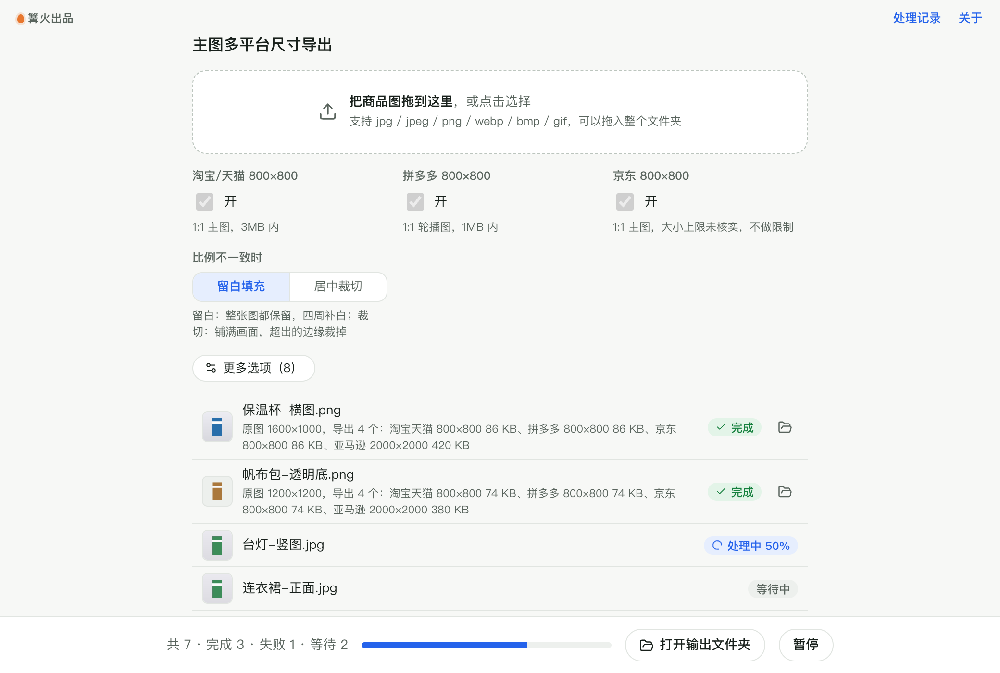

# 主图多平台尺寸导出

> 篝火出品 · 收录于篝火 App 应用区

一张图按各平台尺寸和大小要求一键导出



## 下载

到 [Releases](https://github.com/campfire-code/main-image-resizer/releases/latest) 下载对应安装包：

| 电脑 | 文件 |
|---|---|
| Windows 10 / 11 | `main-image-resizer_版本号_windows-x64-setup.exe` |
| Mac（Apple 芯片） | `main-image-resizer_版本号_mac-arm64.dmg` |
| Mac（Intel 芯片） | `main-image-resizer_版本号_mac-x64.dmg` |

第一次打开：
- **Windows**：如果弹出「Windows 已保护你的电脑」，点「更多信息」→「仍要运行」。
- **Mac**：如果提示「无法验证开发者」，打开「系统设置 → 隐私与安全性」，在下方点「仍要打开」。

## 怎么用

1. 把商品图拖进窗口（可以一次拖多张，或拖入整个文件夹），支持 JPG、PNG、WebP、BMP、GIF。
2. 打开要导出的平台开关。默认勾选淘宝/天猫、拼多多、京东；「更多选项」里还有淘宝/天猫 3:4、Shopee、亚马逊。
3. 需要其他尺寸时，在「自定义尺寸」里填，例如 `1200x1200, 750x1000`，多个用逗号隔开。
4. 「比例不一致时」选适配方式：
   - **留白填充**：整张图都保留，缩放后居中，四周补白色（导出 PNG 时也可以选透明）；
   - **居中裁切**：铺满画面，超出的边缘裁掉，适合主体在中间的图。
5. 点「开始处理」。输出按「平台/原文件名」分文件夹，例如 `下载/主图多平台尺寸导出/拼多多/保温杯.jpg`。同一个平台有多个尺寸时（如淘宝 1:1 和 3:4），文件名后面加 `_宽x高`；自定义尺寸放在「自定义尺寸」文件夹。

**平台预设**（只收录我们有把握的尺寸；**一切以平台最新规则为准**，上传前请在商家后台核对）：

| 平台 | 尺寸 | 大小上限 | 说明 |
|---|---|---|---|
| 淘宝/天猫 | 800×800 | 3MB | 1:1 主图 |
| 淘宝/天猫 | 750×1000 | 3MB | 3:4 主图（服饰等类目） |
| 拼多多 | 800×800 | 1MB | 1:1 轮播图 |
| 京东 | 800×800 | 不限制 | 大小上限我们没有核实到，需要时用「文件大小上限」自己设 |
| Shopee | 1024×1024 | 2MB | 1:1 商品图 |
| 亚马逊 | 2000×2000 | 10MB | 主图要求纯白背景，这个预设固定用白底 |

抖店、1688、小红书的主图规则我们没能核实，暂不内置，请用「自定义尺寸」导出。

**文件大小上限**：默认「按平台要求」（自定义尺寸不限制），也可以统一设成 500KB / 1MB / 2MB / 3MB 或不限制。JPG 超过上限时，从「起始质量」开始逐步降低质量（最低 38%）直到达标；PNG 不能降质量，超过上限会提示改用 JPG。降了质量的版本会在结果里写明「质量降到 xx%」。

**其他说明**
- 原图比目标尺寸小时会放大并提示「可能不够清晰」；短边小于 100 像素的图不处理。
- 透明底图片导出 JPG 时，透明处填白色。
- 全部在本机完成，不联网、不上传。

## 验收用例

默认参数（淘宝/天猫、拼多多、京东，留白填充，JPG，按平台要求）下：

| 操作 | 应得到 |
|---|---|
| 拖入 `samples/保温杯-横图.png`（1600×1000），开始处理 | 输出文件夹里有 `淘宝天猫/保温杯-横图.jpg`、`拼多多/保温杯-横图.jpg`、`京东/保温杯-横图.jpg`，都是 800×800；蓝色杯子完整、上下各有一条白边。结果显示「原图 1600×1000，导出 3 个」 |
| 同一张图，「比例不一致时」改为「居中裁切」再处理 | 三张 800×800 图没有白边，左右两侧被裁掉 |
| 拖入 `samples/帆布包-透明底.png`，「更多选项」里输出格式选 PNG、空白处选「透明」，打开「亚马逊 2000×2000」 | 淘宝/拼多多/京东三张 PNG 背景透明；`亚马逊/帆布包-透明底.png` 是 2000×2000 且背景为白色 |
| 拖入 `samples/台灯-竖图.jpg`（1000×1500），打开「淘宝/天猫 3:4 750×1000」，自定义尺寸填 `1200x1200` | `淘宝天猫` 文件夹里有 `台灯-竖图_800x800.jpg` 和 `台灯-竖图_750x1000.jpg`；`拼多多`、`京东` 里各一张 800×800；`自定义尺寸/台灯-竖图_1200x1200.jpg`（1200×1200，左右留白） |
| 拖入 `samples/小图-300.png` | 能导出，结果末尾提示「已放大，可能不够清晰」 |
| 拖入 `samples/损坏的图.jpg` | 列表里显示失败：「无法识别这张图片，可能已损坏或格式不受支持（支持 JPG、PNG、WebP、BMP、GIF）」 |
| 关掉所有平台开关，自定义尺寸留空，开始处理 | 每个文件显示失败：「还没有选平台：请至少打开一个平台开关，或填写自定义尺寸」 |
| 自定义尺寸填 `1200` | 显示失败：「自定义尺寸「1200」看不懂，请写成 宽x高，例如 1200x1200，多个用逗号隔开」 |

开发自检：`pnpm dev` 后打开 `http://localhost:1420/selftest.html`，每行都应是 PASS（检查输出尺寸、JPG/PNG 文件头、留白 / 透明 / 裁切像素、超过上限自动降质量、损坏图片报错）。

## 自己编译

需要 Node.js 22、pnpm、Rust。

```bash
pnpm install
pnpm test          # 单元测试
pnpm tauri dev     # 开发运行
pnpm tauri build   # 打包
```

界面框架在 `src/kit`（所有 campfire-code 工具共用），本工具的逻辑在 `src/tool`。

## 归属

本工具由**篝火**出品，是篝火 App 应用区收录的开源工具之一，由篝火（GitHub 组织 [campfire-code](https://github.com/campfire-code)）维护与更新。全部工具的目录见 [toolkit-hub](https://github.com/campfire-code/toolkit-hub)。

## 许可证

MIT，版权方为篝火（campfire-code）。
